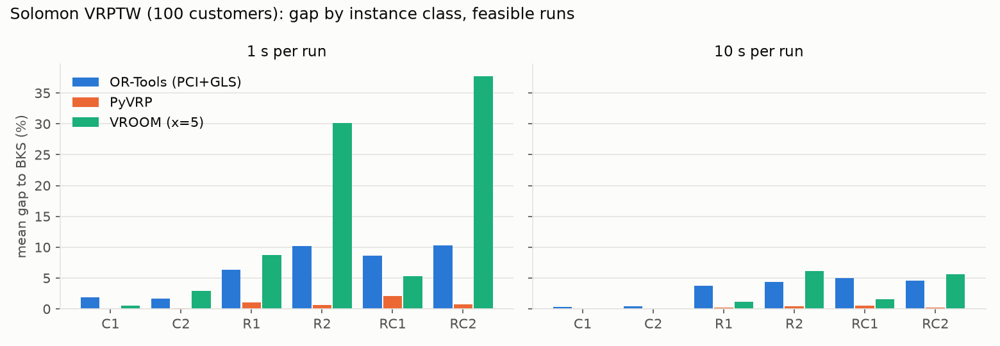
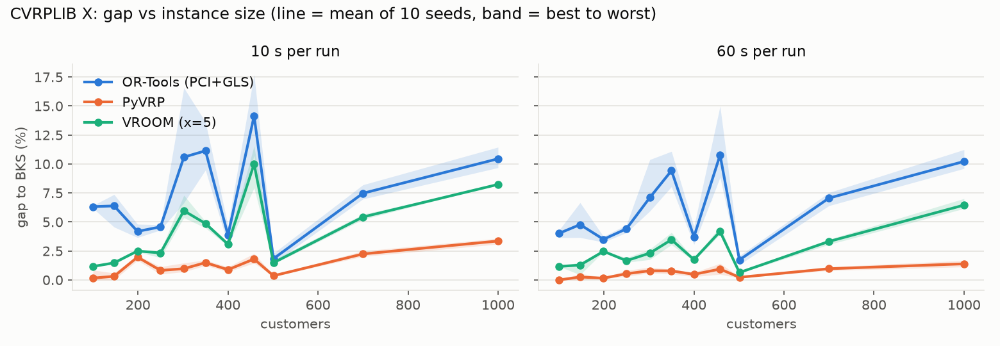
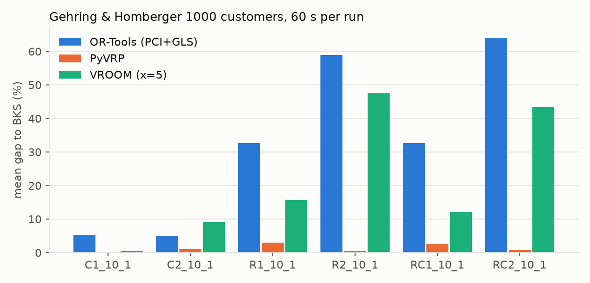

# Algorithm Track · Phase 0 求解器评估报告

日期：2026-09-29 · 范围：OR-Tools 9.15.6755、PyVRP 0.14.0、VROOM 1.15（pyvroom 1.15.2）· 执行方案：`Route_Optimisation_Algorithm_Solver_Benchmark_Plan_CN.md`

> 所有数字均由 `experiments/report.py` 从逐次运行记录计算（`results/summary/*_runs.csv`、`report_tables.md`），每个解都经统一 validator 重新模拟验证。Timefold / jsprit 的 Java 环境已就绪（JDK 21 + Maven），本轮尚未测试。

## 1. 结论（对应 Q1–Q4）

| 问题 | 结论 | 主要证据 |
|---|---|---|
| **Q1 核心求解器** | **PyVRP 作为主求解器**。VROOM 是很好的"快速 API baseline"，但长路线实例质量差、时间上限不可靠，不适合做核心。OR-Tools 仅作为 PyVRP 不支持的约束（软时间窗、breaks）的后备，且需控制规模 | 73 个实例 × 各时间档，PyVRP 只在 3 个 Solomon 实例（10 s）上输给 VROOM，从未输给 OR-Tools；1000 点：PyVRP 1.3%，VROOM 21%，OR-Tools 33% |
| **Q2 严格 Priority** | 原方案的 **10× 权重不能保证严格优先级**；VROOM 原生 priority 同样是加权和；即使数学上精确的"堆叠权重"单次求解，实践中也保护不了高优先级。**采用外部 sequential lexicographic controller（带 warm start）** | P1 反例上 10× 权重和 VROOM native 100% 失败；对抗性随机实例上 PyVRP 单次求解 99% 的运行在 HIGH 层落后，sequential 为 0% |
| **Q3 Traffic 进入搜索** | 本轮未测（按方案作为第二轮独立实验）。三者都不支持真正的 time-dependent travel；建议 PoC 走 T1/T2（分时段矩阵 + 迭代重评估） | 见 §7 |
| **Q4 learned/hybrid** | 不进入 Phase 1 主线。PyVRP 在 100 点实例 10 s 内中位 gap 已为 0.00%，learned 方法的提升空间主要在规模与动态场景，不在静态质量 | §3 |

## 2. 实验设置与公平性

- **机器**：i5-13500H（4 P 核 + 8 E 核）、15.7 GB、Windows 11，Windows 电源模式"最佳性能"、接通电源（`results/metadata.json`）。
- **核心绑定**：实测 E 核单线程慢约 2×，所有正式运行固定在 P 核 0/2/4/6（每物理核 1 线程），4 路并行；运行顺序随机打乱，各求解器承受相同的热/频率条件。
- **每次运行**独立子进程；单线程；外部墙钟计时；每配置 10 个 seed。OR-Tools 与 VROOM 是确定性的，seed 用于打乱 job 输入顺序，以同一协议测量其对输入顺序的敏感性。
- **数据与 BKS**：Solomon 56、CVRPLIB X 11（100→1000 点）、Gehring & Homberger 1000 点 6 个（每类一个），来自 PyVRP/Instances（CVRPLIB 镜像）。VRPTW 用 DIMACS 约定（距离截断到 1 位小数），X 用四舍五入。**216 个官方 BKS 解在我们的转换 + validator 下全部可行且成本逐位一致**，证明取整约定与模型对齐。
- **求解器配置**：PyVRP 全默认。OR-Tools = `PARALLEL_CHEAPEST_INSERTION` + `GUIDED_LOCAL_SEARCH`（选择依据见 §5.1）；文档默认 `PATH_CHEAPEST_ARC` 作为对照变体 `ortools_pca`。VROOM = exploration level 5（CLI 默认）、单线程、`timeout` = 时间档；进程内调用 pyvroom，不含 HTTP/Docker 延迟；costs 矩阵 = 距离矩阵。三者目标均为总距离。
- **运行总数**：5 770 次，除 `ortools_pca` 的 130 次 `NO_SOLUTION` 外全部可行，无崩溃、无被 runner 杀掉的超时。

## 3. 标准 benchmark 结果（gap to BKS，10 seeds 均值）

| 数据集 | 时间 | PyVRP | VROOM | OR-Tools |
|---|---|---|---|---|
| Solomon 100 点 ×56 | 1 s | **0.75%** | 14.46%（中位 6.80%） | 6.63% |
| Solomon 100 点 ×56 | 10 s | **0.22%**（中位 0.00%） | 2.47% | 3.13% |
| Solomon 子集 ×12 | 60 s | **0.00%**（12/12 最好 seed 达到 BKS） | 1.54% | 0.80% |
| CVRPLIB X 100–1000 ×11 | 10 s | **1.31%** | 4.23% | 7.36% |
| CVRPLIB X 100–1000 ×11 | 60 s | **0.59%** | 2.61% | 6.07% |
| HG 1000 点 ×6 | 60 s | **1.32%** | 21.41% | 33.08% |

实例级胜负（按 10 seed 平均 gap；"优 / 平 / 劣"）：

| 对比 | Solomon 1 s | Solomon 10 s | Solomon 60 s | X 10 s / 60 s | HG1000 |
|---|---|---|---|---|---|
| PyVRP vs OR-Tools | 49 / 7 / 0 | 44 / 12 / 0 | 7 / 5 / 0 | 11/0/0 · 11/0/0 | 6 / 0 / 0 |
| PyVRP vs VROOM | 50 / 6 / 0 | 37 / 16 / 3 | 8 / 4 / 0 | 11/0/0 · 11/0/0 | 6 / 0 / 0 |
| VROOM vs OR-Tools | 16 / 4 / 36 | 30 / 12 / 14 | 3 / 4 / 5 | 11/0/0 · 11/0/0 | 5 / 0 / 1 |





要点：

- **PyVRP 全面领先**，差距随规模扩大；seed 间 gap 标准差 ≤ 0.34 个百分点，最稳定。
- **VROOM 的质量取决于路线长度**：短路线类（C1/C2）10 s 内 0.00–0.02%，并在 3 个 Solomon 实例（10 s：R108、RC102、RC108）上优于 PyVRP；但长路线/宽时间窗类（R2、RC2）1 s 时 30–38%、10 s 时仍 ~6%。CVRP 上稳定处于 PyVRP 与 OR-Tools 之间，1000 点 VRPTW 上 21%。
- **VROOM 在小实例上提前结束**：100 点实例平均约 7 s 即停止（60 s 预算用不上），所以 60 s 档不比 10 s 档好多少；大实例则会用满预算。
- **OR-Tools 的 gap 随时间几乎不收敛**：X 上 10 s → 60 s 只从 7.4% 降到 6.1%。1000 点规模基本失效：HG1000 全部 60 次运行为 `LOCAL_OPTIMUM_NOT_REACHED`（GLS 从未启动）。
- **时间上限可靠性**：PyVRP 超时 ≤ 0.43 s。OR-Tools 在 HG1000 平均超 4.9 s、最坏 74 s；**VROOM 在 X 60 s 档有 4 次运行跑了约 130 s（最坏超 77 s），10 s 档的 1000 点实例平均跑 18 s**——VROOM 在构造/局部搜索阶段内部不检查 timeout。对有实时要求的调度 API，这两者都需要外部看门狗。
- **车队规模敏感性**：HG 文件给出 250 辆车而 BKS 仅用 32–100 条路线。把车队限制为 1.2×BKS 路线数后，OR-Tools 33.1% → 18.5%，VROOM 21.4% → 19.7%，PyVRP 不受影响（1.32% → 1.28%）。**用 OR-Tools 时必须严格控制传入的车辆数**。
- **资源**：峰值内存均 < 280 MB（1000 点）。

## 4. Strict Priority 实验

目标：`lexmin(P_CRITICAL, P_HIGH, P_NORMAL, P_LOW, SoftCost)`，P 为各层未服务 value 之和。比较（每次 2 s）：

- `weighted`：原方案，单次求解，class penalty 约 10× 间隔（NORMAL = 最远往返距离，按实例标定）；
- `weighted_fixed`：同上但用固定"米"单位表（100/1 000/10 000/100 000），模拟合作方直接配置；
- `stacked`：单次求解，penalty 逐层堆叠，保证每层严格压过所有下层 + 任何软成本（带 int64 溢出检查）；
- `sequential`：外部控制器，每层一次求解并锁定已服务集合，下一层从上一层解 **warm start**，最后一次求解优化软成本；
- `native`（仅 VROOM）：VROOM 自带的层级目标——先最大化已分配 job 的 priority 之和（0–100；映射 CRITICAL 100 / HIGH 10 / NORMAL 1 / LOW 0，乘 value 封顶 100），再最大化分配数量，最后最小化成本。VROOM 没有 drop penalty 和 warm start，因此不能跑其他四种策略。

### 4.1 构造反例（5 seeds，命中严格最优向量的比例；OR-Tools 与 PyVRP 结果相同）

| Case | 场景 | weighted | weighted_fixed | stacked | sequential | VROOM native |
|---|---|---|---|---|---|---|
| P1 | 1 HIGH vs 20 NORMAL，容量只够一边 | **0%** | **0%** | 100% | 100% | **0%** |
| P2 | CRITICAL 在 60 km 外 | 100% | **0%** | 100% | 100% | 100% |
| P3 | HIGH 层内按 value 取舍 | 100% | 100% | 100% | 100% | 100% |
| P4 | 服务最后 1 个 NORMAL 需多开一辆固定成本 1e6 的车 | **0%** | **0%** | 100% | 100% | 100% |

P4 中 weighted 实际上**丢弃了全部 5 个 job**（第一辆车的固定成本就超过所有 penalty 之和）。P2 说明 penalty 数值依赖距离尺度。VROOM 因"先最大化分配"而天然通过 P2/P4，但 priority 之和仍是加权和，P1 中 20×1 > 1×10。

### 4.2 随机压力测试（30 实例 × 5 seeds）

"在 HIGH 层落后" = 与该实例上任一方法找到的最优优先级向量相比，第一个出现差异的层是 HIGH（即放弃了本可保住的 HIGH job）。

**对抗族**（高优先级 job 体积大、容量约为需求的 50%——即 P1 模式）：

| 求解器 | 策略 | 在 HIGH 层落后 | 平均未服务 HIGH | 平均未服务 NORMAL | 距离 |
|---|---|---|---|---|---|
| PyVRP | weighted | 99.3% | 3.79 | 10.6 | 5 511 |
| PyVRP | stacked | 99.3% | 4.05 | 10.1 | 5 598 |
| PyVRP | **sequential** | **0.0%** | **1.43** | 20.7 | 4 821 |
| OR-Tools | weighted | 32.7% | 1.76 | 19.0 | 5 087 |
| OR-Tools | stacked | 32.0% | 1.75 | 19.0 | 5 097 |
| OR-Tools | **sequential** | **16.7%** | **1.60** | 20.3 | 4 864 |
| VROOM | native | 39.3% | 1.83 | 18.0 | 5 030 |

**均匀族**（各类 demand 相同）中没有任何方法在 CRITICAL/HIGH 层落后；VROOM native 在 93% 的运行中达到字典序最优（所有方法中最高），因为它总是先服务尽可能多的 job。优先级冲突只在"高优先级 job 更占资源"时出现，而这恰是 Voi 场景（高价值区域电池需求大）的常态。

结论：

1. 10× 权重在结构上就不是字典序（P1、P4），且依赖尺度（P2）；VROOM 的原生 priority 同样是加权和。
2. **即使权重精确（stacked），单次元启发式搜索也达不到最高层的最优**：巨大 penalty 让 PyVRP 的搜索失真。严格优先级需要**分阶段求解**。
3. Sequential 的代价在 NORMAL 层（PyVRP 20.7 vs 10.6、OR-Tools 20.3 vs 19.0）。一部分是保住体积大的 HIGH 必然让出的容量（这正是严格优先级要求的取舍），另一部分来自"锁定已服务集合"（比真正字典序更严格）和每阶段只有 1/5 时间的效率损失。Phase 1 可通过"只锁数量不锁集合"、按层分配时间来缩小后者。
4. warm start 是必需的：不做 warm start 时，OR-Tools 的 sequential 在均匀族上约 21% 的运行在后续阶段重新装箱失败（找不到初始解）。
5. 以上数字在两次完整重跑间波动几个百分点（2 s 时限下的正常噪声），结论不变。

## 5. 工程发现（选型时同样重要）

### 5.1 OR-Tools

- **文档默认 `PATH_CHEAPEST_ARC` 在紧时间窗上找不到可行初始解**：8 个 Solomon 实例（R101/102/103/105/106、RC101/102/105）在所有 seed、1 s 与 10 s 下均 `NO_SOLUTION`（R1 类 36%、RC1 类 27.5% 的运行）。插入类策略全部可行；`PARALLEL_CHEAPEST_INSERTION` 是唯一在 Solomon/X/HG 上都可行且接近最好的策略（基于 4 个实例的 6 策略对比，属于轻度调参，已披露）。
- **`SetAllowedVehiclesForIndex` 的 Python 绑定在 9.15 不可用**（拒绝所有序列类型），且传空列表语义为"允许所有车辆"。改用 `VehicleVar(index).SetValues(...)`，并有测试覆盖"没有车辆具备该 skill"的情况。
- 大规模下 time limit 不可靠（§3），车队规模强烈影响质量（§3）。

### 5.2 PyVRP

- **0.14 API 与旧文档/执行方案示例不同**：depot/client 挂在 `Location` 上，路线迭代得到 `ScheduledActivity`。
- **大数值尺度会返回不可行解**：PyVRP 用自适应罚分松弛容量/时间窗，罚分上限 `max_penalty = 1e5`/单位。当固定成本或 prize 超过该量级（例如固定成本 1e6，或 stacked penalty），超载的不可行解反而"更便宜"。adapter 已将上限设为 `max(1e5, 10 × 最大成本系数)`；标准 benchmark 实例不受影响。**任何 big-M 建模都必须检查这一点。**
- 不支持：skills（可用多 profile 矩阵变通，未测）、软时间窗、breaks、真正 time-dependent travel。

### 5.3 VROOM（pyvroom）

- **pyvroom 1.15.2 在 Windows + numpy 2 上无法设置矩阵**：它按 `uint32` 转换，numpy 2 在 Windows 上给出缓冲区格式 `L`，而绑定只接受 `I`。adapter 用 `np.uintc` 自建 `_vroom.Matrix` 绕过（依赖私有模块，升级时需复查）。
- **没有 drop penalty、没有"必须服务"标记**：VROOM 总是先最大化分配数量，不会为省成本放弃可服务的 job；不可分配的必服务 job 只会出现在 unassigned 中（validator 报 `UNSERVED_REQUIRED`）。这与"optional + penalty"的业务语义不同。
- **timeout 不严格**（§3），小实例提前结束；pyvroom 本轮未接 warm start（VROOM 的 vehicle `steps` 可做初始解，未测）。
- 原生支持 skills、breaks、shipments、多维容量。

### 5.4 约束能力矩阵（本轮实测 / 文档）

| 约束 | OR-Tools | PyVRP | VROOM |
|---|---|---|---|
| 容量、硬时间窗、班次 | ✅ 实测 | ✅ 实测 | ✅ 实测 |
| Optional job / drop penalty | ✅ 实测（Disjunction） | ✅ 实测（prize） | ⚠️ 只有"尽量多分配"，无 penalty |
| 必须服务（hard） | ✅ | ✅ | ❌ 只能靠 priority 倾向 |
| 固定车辆成本 | ✅ 实测 | ✅ 实测（需 max_penalty 修正） | ✅ 实测 |
| Skills / 车辆兼容 | ✅ 实测（VehicleVar，绑定 bug 已绕过） | ⚠️ 不支持；profile 变通未测 | ✅ 实测 |
| 严格多层 priority | ❌ 需外部控制器 ✅ 实测 | ❌ 需外部控制器 ✅ 实测 | ❌ 原生为加权和；无法接外部控制器 |
| Warm start | ✅ 实测 | ✅ 实测 | 文档支持（steps），未接 |
| Pickup & delivery | 文档支持，未测 | 文档支持（0.14），未测 | 文档支持（shipments），未测 |
| 软时间窗 | 文档支持，未测 | ❌ | ❌ |
| Breaks | 文档支持，未测 | ❌ | 文档支持，未测 |
| Time-dependent travel | ❌（仅静态矩阵） | ❌ | ❌ |
| 可靠的时间上限 | ⚠️ 大规模超时 | ✅ | ❌ 最多超 77 s |

## 6. 建议的技术路线

1. **Core = PyVRP + 外部 sequential lexicographic controller**（`priority/lexicographic.py` 已可用，含 warm start 和溢出检查）。
2. **VROOM 定位为快速 baseline / 对照**：适合短路线、"尽量多服务"类场景的快速估算和 sanity check；不做核心——长路线质量差、无 drop penalty/必服务语义、时间上限不可靠。
3. **OR-Tools 保留为 rich-constraint fallback**，仅在出现 PyVRP 无法表达的约束（软时间窗等）时使用，且限制规模（≤ 数百点）、严格控制车队数、使用插入类初始解策略。
4. **Voi 场景的约束需尽早验证 PyVRP 覆盖度**：换电车辆的电池容量（多维容量，PyVRP 支持）、车辆类型差异（profile）、软时间窗（不支持 → 需评估是否可用硬窗 + 优先级替代）。
5. 不采纳原方案中"约 10× penalty 即代表 priority"的写法；对外 API 以 priority class 表达，内部由控制器保证字典序。

## 7. 下一步

| 优先级 | 事项 |
|---|---|
| 高 | 构造 Voi 风格 rich 实例（斯德哥尔摩坐标、换电 + 调度、priority class、车型差异），跑三个求解器与各 priority 策略 |
| 高 | Traffic T1：早高峰/平峰/晚高峰三套静态矩阵分别求解，评估计划差异；T2：迭代按出发时刻换 bucket |
| 中 | Timefold（原生 Hard/Medium/Soft 分层 score，与 sequential 对照）；JDK 21 + Maven 已就绪 |
| 中 | Li & Lim pickup-delivery；PyVRP skills 的 profile 变通；VROOM warm start（steps） |
| 低 | sequential 改进：只锁数量、按层分配时间；OR-Tools 的 fleet 自动收紧 |

## 8. 局限性

- 单台笔记本；每个求解器单一配置（OR-Tools 未做 metaheuristic 调参，PyVRP 默认，VROOM exploration 5）。
- HG 仅 1000 点、每类 1 个实例；200–800 点因可得 BKS 的目标约定不一致（先最少车辆、实数距离）而未用。
- 车队敏感性只有 3 个 seed；priority 实验每次 2 s，且为合成实例。
- VROOM 通过 pyvroom 进程内调用；vroom-express HTTP 服务形态（含序列化与网络开销）未测。
- 所有结果为静态矩阵、无 traffic；不代表实时重规划性能。

## 复现

```bash
cd route-optimisation-benchmark
py -3.13 -m venv .venv && .venv/Scripts/python -m pip install -r environments/requirements-python.txt
.venv/Scripts/python -m data.download        # 实例 + BKS
bash experiments/run_all.sh                  # priority + 全部 benchmark + 图表（首次全量约 6 h）
.venv/Scripts/python -m pytest               # 305 个测试
```
