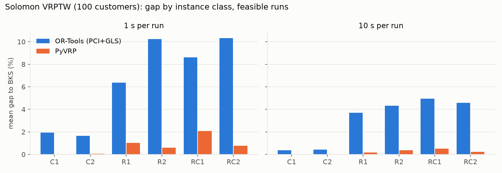
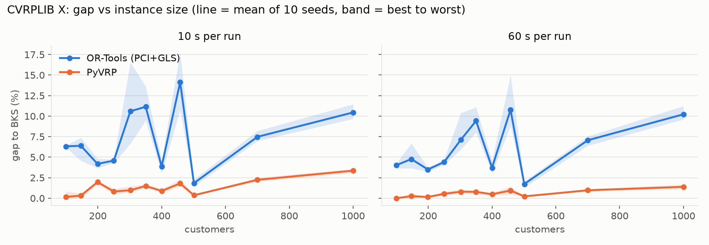
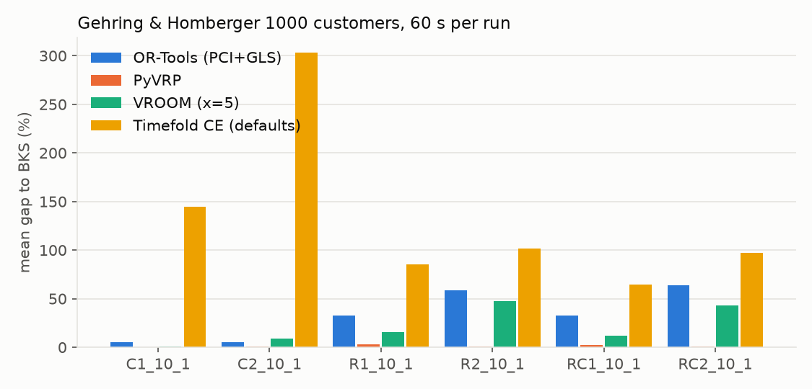

# Algorithm Track · Phase 0 Solver Evaluation Report

Scope: OR-Tools 9.15.6755, PyVRP 0.14.0, VROOM 1.15 (pyvroom 1.15.2) and Timefold Solver 2.7.0 Community Edition. Standard benchmarks ran 29 Sep – 2 Oct 2026; the traffic studies on 5–7 Oct; the Voi studies on 11 Oct. English translation of the Chinese report (`Phase0_Algorithm_Report_CN.md`); section numbers and figures are identical.

> All numbers are computed by `experiments/report.py` (standard benchmarks) and the study runners from per-run records (`results/summary/*_runs.csv`, `report_tables.md`). Every solution was re-simulated by an independent validator. jsprit was not tested.

## 1. Conclusions (Q1–Q4)

| Question | Conclusion | Main evidence |
|---|---|---|
| **Q1 Core solver** | **Use PyVRP as the core solver.** VROOM is a good fast API baseline, but its quality is poor on instances with long routes and its time limit is unreliable. OR-Tools is only a fallback for constraints PyVRP lacks (soft time windows, breaks), and only at limited size. **Timefold Community Edition is not good enough to be the core** (it lacks the Enterprise nearby selection), but its modelling flexibility for traffic and complex rules is worth keeping an eye on. **Voi-style instance (§6): PyVRP expresses every constraint of the day**: 5 natively; skills, "any k of n", soft deadlines and driver breaks through workarounds, with 0 violations in independent validation. At M size it serves about 64 more swaps than OR-Tools, but it must start from an empty solution, and the break workaround conflicts with new time windows during re-planning | 73 instances × each time budget: PyVRP lost to VROOM on only 3 Solomon instances (10 s) and never lost to OR-Tools or Timefold; 1,000 stops: PyVRP 1.3 %, VROOM 21 %, OR-Tools 33 %, Timefold 133 %; after tuning with equal budgets, OR-Tools' best configuration is still its default and the gap is unchanged (§3.1); 240 runs on the Voi instances (§6.3) |
| **Q2 Strict priority** | The original design's **10× weights do not guarantee strict priority**; VROOM's native priority is a weighted sum; **Timefold's native layered BendableScore has the right objective, but its search does not reach the optimum at the top layer**; even exact "stacked" weights in a single solve fail. **Use an external sequential lexicographic controller with warm start**: it reaches 0 % falling behind at the HIGH layer on both PyVRP and Timefold. Voi re-check: 10× weights deliberately give up NORMAL jobs, and the controller must **keep the lower classes in every stage** | 10 s adversarial family: sequential (PyVRP, Timefold) 0 % behind at HIGH; Timefold native 53 %, VROOM native 39 %; Voi M: NORMAL value lost 17.5 with 10× weights vs 2.1 staged, and 129 for the old version that drops lower classes (§6.3) |
| **Q3 Traffic inside the search** | **Yes, and it is worth it: put traffic inside PyVRP's search by copying each customer per time slot.** Ignoring traffic, 50–70 % of plans have at least one late customer; PyVRP with slot copies is 100 % on time at both congestion levels, drives as much as with the day-average matrix (−0.4 % to +0.3 %) and 1–4 % less than conservative planning on the peak matrix. Recommended for the PoC (90-minute slots) | Synthetic traffic experiment (§5), 1,020 runs |
| **Q4 Learned / hybrid** | Not in the Phase 1 mainline. PyVRP already reaches a median gap of 0.00 % on 100-stop instances within 10 s; the room for learned methods lies in scale and dynamic settings, not static quality | §3 |

## 2. Setup and fairness

- **Machine**: i5-13500H (4 P-cores + 8 E-cores), 15.7 GB, Windows 11, power mode "best performance", on AC power (`results/metadata.json`).
- **Core pinning**: an E-core is measured about 2× slower single-threaded, so every timed run is pinned to P-cores 0/2/4/6 (one thread per physical core), 4 in parallel; run order is shuffled so every solver sees the same thermal and frequency conditions.
- **Each run** is a separate subprocess, single-threaded, timed by an external wall clock, with 10 seeds per configuration. OR-Tools and VROOM are deterministic; their seed shuffles the job order, measuring their sensitivity to input order with the same protocol.
- **Power and standby guards**: Windows Modern Standby pauses desktop processes (one Timefold "hang" was caused by it). Every run records whether it was on AC power; `experiments/standby_check.py` reads Kernel-Power events 506/507, and every result that overlaps a standby period or ran on battery is deleted and rerun. The Timefold round had 0 contaminated runs.
- **Data and best known solutions (BKS)**: 56 Solomon, 11 CVRPLIB X (100→1,000 stops) and 6 Gehring & Homberger 1,000-stop instances (one per class), from PyVRP/Instances (a CVRPLIB mirror). VRPTW uses the DIMACS convention (distances truncated to one decimal), X uses rounding. **All 216 official BKS solutions are feasible under our conversion and validator, with costs matching to the last digit**, so the rounding conventions and the model agree.
- **Solver configuration**:
  - PyVRP: all defaults.
  - OR-Tools: `PARALLEL_CHEAPEST_INSERTION` + `GUIDED_LOCAL_SEARCH` (reasons in §7.1); the documented default `PATH_CHEAPEST_ARC` runs as the comparison variant `ortools_pca`.
  - VROOM: exploration level 5 (CLI default), single thread, `timeout` = time budget; pyvroom is called in-process, without HTTP or Docker overhead.
  - Timefold: Community Edition default phases (construction + late acceptance local search), list-variable model (same structure as the official quickstart), `NO_ASSERT`, a new JVM per solve, **with a 5 s warm-up solve in the same JVM before timing** (JIT warm-up, not counted in the budget; cold start measured separately, §7.4). The Java scores match the Python validator to the last digit.
  - All four minimise total distance (+ fixed vehicle cost).
- **Total runs**: 9,000. All returned a solution except 130 `NO_SOLUTION` results of `ortools_pca`; no crashes and no runs killed by the runner.

## 3. Standard benchmark results (gap to BKS, mean over 10 seeds)

| Dataset | Time | PyVRP | VROOM | OR-Tools | Timefold CE |
|---|---|---|---|---|---|
| Solomon 100 stops ×56 | 1 s | **0.75 %** | 14.46 % (median 6.80 %) | 6.63 % | 55.94 % (558/560 feasible) |
| Solomon 100 stops ×56 | 10 s | **0.22 %** (median 0.00 %) | 2.47 % | 3.13 % | 28.13 % |
| Solomon subset ×12 | 60 s | **0.00 %** (best seed reaches BKS on 12/12) | 1.54 % | 0.80 % | 2.61 % |
| CVRPLIB X 100–1,000 ×11 | 10 s | **1.31 %** | 4.23 % | 7.36 % | 71.34 % |
| CVRPLIB X 100–1,000 ×11 | 60 s | **0.59 %** | 2.61 % | 6.07 % | 42.74 % |
| HG 1,000 stops ×6 | 60 s | **1.32 %** | 21.41 % | 33.08 % | 132.75 % |

Wins per instance (mean gap over 10 seeds; "better / tie / worse"):

| Comparison | Solomon 1 s | Solomon 10 s | Solomon 60 s | X 10 s / 60 s | HG1000 |
|---|---|---|---|---|---|
| PyVRP vs OR-Tools | 49 / 7 / 0 | 44 / 12 / 0 | 7 / 5 / 0 | 11/0/0 · 11/0/0 | 6 / 0 / 0 |
| PyVRP vs VROOM | 50 / 6 / 0 | 37 / 16 / 3 | 8 / 4 / 0 | 11/0/0 · 11/0/0 | 6 / 0 / 0 |
| PyVRP vs Timefold | 56 / 0 / 0 | 56 / 0 / 0 | 10 / 2 / 0 | 11/0/0 · 11/0/0 | 6 / 0 / 0 |
| VROOM vs OR-Tools | 16 / 4 / 36 | 30 / 12 / 14 | 3 / 4 / 5 | 11/0/0 · 11/0/0 | 5 / 0 / 1 |
| Timefold vs OR-Tools | 0 / 0 / 56 | 0 / 0 / 56 | 1 / 2 / 9 | 0/0/11 · 2/0/9 | 0 / 0 / 6 |





Key points:

- **PyVRP leads everywhere**, and the lead grows with size; its gap standard deviation across seeds is ≤ 0.34 percentage points, the most stable.
- **VROOM's quality depends on route length**: on short-route classes (C1/C2) it reaches 0.00–0.02 % within 10 s and beats PyVRP on 3 Solomon instances (10 s: R108, RC102, RC108); on long-route / wide-window classes (R2, RC2) it is 30–38 % at 1 s and still about 6 % at 10 s. It stops by itself after about 7 s on 100-stop instances.
- **OR-Tools' gap barely improves with time** (X: only from 7.4 % at 10 s to 6.1 % at 60 s) and it essentially fails at 1,000 stops (every HG1000 run ends with `LOCAL_OPTIMUM_NOT_REACHED`).
- **Timefold Community Edition converges slowly and scales poorly**: with 60 s on 100 stops it reaches 2.6 % (and beats VROOM on 3 instances), but it is 28 % at 10 s and 40–150 % above 500 stops. It evaluates about 40,000–110,000 moves per second, so the model is not the bottleneck; the gap comes from the search. **Nearby selection, which restricts candidate moves to nearby customers, is an Enterprise feature**; the Community Edition picks among all positions at random, which gets less efficient as size grows (this quantifies the project document's "Key scaling features are Enterprise only").
- **Time-limit reliability**: PyVRP overruns by ≤ 0.43 s and Timefold's solve by ≤ 2.6 s (plus JVM start-up and warm-up, §7.4). OR-Tools overruns by 4.9 s on average on HG1000, 74 s at worst; VROOM ran about 130 s four times in the X 60 s budget. A real-time dispatch API would need an external watchdog for these two.
- **Fleet-size sensitivity**: the HG files allow 250 vehicles while the BKS uses only 32–100 routes. Limiting the fleet to 1.2 × the BKS route count improves OR-Tools from 33.1 % to 18.5 % and VROOM from 21.4 % to 19.7 %, leaves PyVRP unaffected (1.32 % → 1.28 %), and improves Timefold from 132.8 % to 81.9 %, but 8 of 18 Timefold runs then violate time windows (all of C1/C2 infeasible): with a tight fleet the Community Edition struggles even to find a feasible solution.
- **Resources**: peak memory of the Python processes < 280 MB; peak Timefold JVM heap ≤ 424 MB (1,000 stops).

### 3.1 Tuning: can tuning close OR-Tools' gap?

Protocol (`experiments/tuning.py`, `run_tuning.sh`): OR-Tools and PyVRP get **the same tuning budget**: 24 random configurations each (the first being the main benchmark's default), scored on 9 **training instances** (6 Solomon + 3 X not in the test set) × 2 seeds × 10 s (infeasible counts as 100 %). The best configuration is then compared on a **held-out test set** (the other 50 Solomon, 11 X and 6 HG1000 instances, seeds 0–4) against **the default rerun on the same day**. Random sampling does not cover "the default with one change", so 4 one-factor-at-a-time (OFAT) variants per solver were added.

OR-Tools search space: first solution {parallel insertion, local insertion, Savings} × metaheuristic {GLS, simulated annealing, two tabu searches} × the iterated local search new in 9.15 (ruin and recreate: SISR / random walk / close routes) × neighbourhood ratio × GLS λ × a set of LNS operators that are off by default. PyVRP: number of neighbours, wait-time weight, history length, restart condition, perturbation strength, `exhaustive_on_best`, target feasible share.

| Test set | Solver | Default (same day) | Tuned (same day) |
|---|---|---|---|
| Solomon 10 s | OR-Tools | 3.85 % | 3.85 % (best configuration = default) |
| | PyVRP | 0.25 % | 0.24 % |
| X 10 s / 60 s | OR-Tools | 7.72 % / 6.48 % | same as default |
| | PyVRP | 1.75 % / 0.72 % | 1.66 % / 0.67 % |
| HG1000 60 s | OR-Tools | 38.9 % | same as default |
| | PyVRP | 1.61 % | **3.42 %** |

- **OR-Tools' default (parallel insertion + GLS) ranks first of 24.** The best single change (default + close-routes ruin and recreate) improves the training score only from 4.33 % to 4.09 %; SISR changes nothing; the LNS operator set (6.28 %) and simulated annealing (7.84 %) are worse; a smaller neighbourhood (0.1 / 0.3) is clearly worse.
- **The gap is not a matter of parameters**: on the same day OR-Tools is still 15× behind PyVRP on Solomon, 4–10× on X and 24× on HG. What tuning gains (about 0.2 percentage points) is an order of magnitude smaller than the gap (about 4 points). The root cause is the search framework: OR-Tools is generic constraint programming with local search, PyVRP an iterated local search designed for VRPs.
- **PyVRP's tuned configuration overfits**: "20 neighbours", chosen on 100–300-stop training instances, is slightly better on X but clearly worse at 1,000 stops (3.42 % vs 1.61 %). **Keep PyVRP's defaults.**
- **Day-to-day drift**: with the same configuration and seed, today's results are generally a little worse than on 29 Sep (OR-Tools Solomon 3.25 % → 3.85 %, HG 33.6 % → 38.9 %; PyVRP X 10 s 1.33 % → 1.75 %), so the machine's state differs. A solver that uses its whole budget while still improving (OR-Tools) is hit hardest. **Small differences across dates are not comparable; comparisons must be made within one session** (every comparison in this section is same-day).

## 4. Strict priority experiments

Target: `lexmin(P_CRITICAL, P_HIGH, P_NORMAL, P_LOW, SoftCost)`, where P is the total value of unserved jobs in a class. Compared:

- `weighted`: the original design, one solve, class penalties about 10× apart (NORMAL = longest round trip, calibrated per instance);
- `weighted_fixed`: the same with a fixed table in metres (100 / 1,000 / 10,000 / 100,000), as a partner might configure it;
- `stacked`: one solve with penalties stacked so each class strictly outweighs all lower classes plus any soft cost (with an int64 overflow check);
- `sequential`: an external controller that solves once per class and locks the set of served jobs; the next stage **warm-starts** from the previous one; a last solve optimises soft cost;
- `native`: the solver's own priority. VROOM's 0–100 priority (first maximises the sum of assigned priorities, mapped CRITICAL 100 / HIGH 10 / NORMAL 1 / LOW 0); Timefold's layered `BendableScore` (1 hard + 5 soft levels [CRITICAL, HIGH, NORMAL, LOW, cost], i.e. native strict lexicographic order).

In the priority experiments Timefold uses a **construction sorted by difficulty (required first, then higher priority, then larger demand)**. Without sorting, small LOW / NORMAL jobs fill the vehicles first and no single local-search move can fit a large CRITICAL job back in (capacity is a hard constraint), so CRITICAL jobs are still missing after 20 s. Note: setting only the comparator is silently ignored; `ValueSorterManner.DESCENDING` must be set explicitly.

### 4.1 Constructed counter-examples (5 seeds, 2 s, share of runs reaching the strictly optimal vector)

| Case | Scenario | OR-Tools / PyVRP weighted | weighted_fixed | stacked | sequential | VROOM native | Timefold native |
|---|---|---|---|---|---|---|---|
| P1 | 1 HIGH vs 20 NORMAL, capacity fits only one side | **0 %** | **0 %** | 100 % | 100 % | **0 %** | 100 % |
| P2 | CRITICAL 60 km away | 100 % | **0 %** | 100 % | 100 % (Timefold 80 %) | 100 % | 100 % |
| P3 | Choosing by value within HIGH | 100 % | 100 % | 100 % | 100 % | 100 % | 100 % |
| P4 | Serving the last NORMAL needs another vehicle with fixed cost 1e6 | **0 %** | **0 %** | 100 % | 100 % | 100 % | 100 % |

Timefold's weighted also "passes" P1, but only because its local search cannot find the move "remove 1 large job, insert 20 small ones"; its objective prefers dropping the HIGH job just as much, so the pass is luck. In P4, weighted actually **drops all 5 jobs** (the first vehicle's fixed cost exceeds all penalties combined). P2 shows that penalty values depend on the distance scale. Timefold sequential's 80 % in P2 comes from the 2 s budget being cut into 5 stages of 0.4 s, each in a new JVM (see 4.3).

### 4.2 Random stress test (2 s, 30 instances × 5 seeds)

"Behind at HIGH" = compared with the best priority vector any method found on that instance, the first class that differs is HIGH (a HIGH job that could have been kept was given up).

**Adversarial family** (high-priority jobs are large, capacity about 50 % of demand: the P1 pattern):

| Solver | Strategy | Behind at HIGH | Mean unserved CRITICAL | Mean unserved HIGH | Mean unserved NORMAL | Distance |
|---|---|---|---|---|---|---|
| PyVRP | weighted | 98.7 % | 0.00 | 3.57 | 11.2 | 5,411 |
| PyVRP | stacked | 98.7 % | 0.00 | 3.72 | 10.8 | 5,552 |
| PyVRP | **sequential** | **0.0 %** | 0.00 | **1.43** | 20.7 | 4,820 |
| OR-Tools | weighted | 32.7 % | 0.00 | 1.76 | 18.9 | 5,081 |
| OR-Tools | stacked | 31.3 % | 0.00 | 1.75 | 19.0 | 5,104 |
| OR-Tools | **sequential** | **12.0 %** | 0.00 | **1.55** | 20.5 | 4,839 |
| VROOM | native | 39.3 % | 0.00 | 1.83 | 18.0 | 5,031 |
| Timefold | native | 53.3 % | 0.00 | 2.35 | 16.4 | 10,102 |
| Timefold | sequential (fails at 2 s) | 11.3 %* | **4.79** | 5.42 | 6.8 | 9,737 |

\* 84 % of Timefold sequential runs are already behind at CRITICAL: a new JVM with 0.4 s per stage cannot even finish construction, and a stage's result is locked and cannot be recovered. This is a budget problem, not a problem of the method; see 4.3.

In the **uniform family** (equal demand for all classes) no OR-Tools, PyVRP or VROOM run falls behind at CRITICAL or HIGH (Timefold 1–11 % at 2 s, more for sequential, for the same reason); VROOM native reaches the lexicographic optimum in 94 % of runs (the highest of all methods), because it always serves as many jobs as possible first. Priority conflicts only arise when high-priority jobs use more resources, and that is the normal case for Voi (high-value areas need many batteries).

### 4.3 10 s adversarial family (key strategies, the same longer budget for every solver)

At 2 s Timefold mostly measures JVM start-up and JIT (about 2,800 move evaluations per second at 2 s, about 50,000 at 20 s), so every solver's key strategy was rerun at 10 s:

| Solver | Strategy | Behind at HIGH | Mean unserved HIGH | Mean unserved NORMAL | Lexicographically optimal | Distance |
|---|---|---|---|---|---|---|
| PyVRP | sequential | **0.0 %** | 1.43 | 20.7 | 44.0 % | 4,815 |
| Timefold | **sequential** | **0.0 %** | 1.43 | 20.5 | **54.7 %** | 5,145 |
| OR-Tools | sequential | 7.3 % | 1.51 | 20.7 | 31.3 % | 4,765 |
| VROOM | native | 39.3 % | 1.83 | 18.0 | 34.0 % | 5,030 |
| Timefold | native (BendableScore) | 53.3 % | 2.35 | 15.9 | 39.3 % | 6,733 |

Conclusions:

1. 10× weights are structurally not lexicographic (P1, P4) and depend on scale (P2); VROOM's native priority is also a weighted sum.
2. **Writing the lexicographic order into the objective is not enough**: neither exact stacked weights (PyVRP 99 % behind at HIGH) nor Timefold's native layered BendableScore (still 53 % at 10 s) lets a single metaheuristic search reach the optimum at the top class. Fitting one more large HIGH job means removing several small jobs at once, which is beyond a single move.
3. **Staged solving is ≤ 7 % on all three solvers that accept an external controller, and 0 % on two of them** (VROOM has no drop penalty and no warm start, so it cannot be driven by a controller). The same Timefold drops from 53 % to 0 % when driven by the external controller and gives the most lexicographically optimal solutions. Strict priority belongs in a controller, not in any solver's weights or layers.
4. Sequential pays at the NORMAL layer (about 20.5 vs 16–19 unserved). Part of this is the capacity that keeping large HIGH jobs necessarily takes (exactly the trade-off strict priority asks for); the rest comes from locking the served set (stricter than true lexicographic optimisation) and from splitting the time. Phase 1 can shrink the latter by locking counts instead of sets and by allocating time per layer.
5. Warm start is required: without it, OR-Tools sequential fails to re-pack the locked jobs in later stages in about 21 % of the uniform-family runs.
6. These numbers move by a few percentage points between full reruns (normal noise at short time limits); the conclusions do not change.

## 5. Traffic experiment (Q3): should traffic be inside the search?

**Design** (`traffic/`): a synthetic 20 × 20 km city with the depot in the west, 100 customers per instance (60 % with a 1-hour window), shift 07:00–16:00 (every route crosses the morning peak). Travel times follow the Ichoua model: one speed per 15-minute slot, more congested towards the centre, integrated slot by slot (which guarantees FIFO). Two congestion levels: **moderate T** (city centre about 2.5× slower at peak, 1.11× on the day average) and **heavy H** (about 4.7× slower, 1.16× on average), 10 instances × 3 seeds each, 30 s per run, the same total budget for every approach. Every plan is re-scored in the "real" time-dependent traffic (`traffic/evaluate.py`). Timefold's Java time-dependent travel times match the Python model to the second (tested).

| Solver | Approach | On-time plans T / H | Late customers per plan T / H | Driving vs PyVRP + day-average matrix T / H | Planned vs real driving time T / H |
|---|---|---|---|---|---|
| PyVRP | T0 free-flow matrix | 50 % / 30 % | 0.83 / 1.30 | −0.3 % / −0.4 % | **underestimated by 8.0 % / 10.6 %** |
| PyVRP | T0 day-average matrix | 50 % / 40 % | 0.87 / 0.90 | reference | −1.1 % / −0.8 % |
| PyVRP | **T0 peak matrix (conservative)** | **100 % / 100 %** | 0 / 0 | +1.1 % / +3.5 % | overestimated by 44 % / 66 % |
| PyVRP | **T2 iterative re-estimation** | 97 % / 70 % | 0.03 / 0.30 | +1.0 % / +1.6 % | −0.9 % / −1.9 % |
| OR-Tools | T0 day average | 53 % / 50 % | 0.63 / 0.73 | +4.5 % / +4.2 % | −1.3 % / −1.2 % |
| OR-Tools | T2 iterative re-estimation | 93 % / 63 % | 0.07 / 0.37 | +6.4 % / +8.6 % | −1.4 % / −2.6 % |
| Timefold | T0 day average | 53 % / 37 % | 0.50 / 0.97 | +17.3 % / +14.8 % | −1.4 % / −1.3 % |
| Timefold | T2 iterative re-estimation | 93 % / 87 % | 0.07 / 0.13 | +23.9 % / +30.3 % | −0.5 % / −1.7 % |
| Timefold | **T3 traffic inside the search** | **100 % / 100 %** | 0 / 0 | +18.4 % / +13.5 % | exact |

"On-time plan" = no customer late and no vehicle over its shift anywhere in the plan. All 540 runs are valid (all customers served, capacity respected), with no standby or battery contamination.

Conclusions:

1. **Ignoring traffic causes problems**: free-flow planning underestimates driving time by 8–11 %, and more than half of the plans have at least one late customer; the heavier the congestion, the worse.
2. **Within one solver, traffic inside the search (T3) is the cleanest**: Timefold goes from 53 % / 37 % on time to 100 % / 100 %, with driving time about equal to its own static plans (+1 % / −1 %). Its overall extra driving is the Community Edition's solution quality (§3), not a cost of T3.
3. **But PyVRP can also be 100 % on time**: planning conservatively on the peak matrix costs only 1–4 % more driving (about 0.4 more vehicles on average in heavy congestion). The price is a heavily overestimated plan (44–66 %), so its ETAs cannot be given to customers.
4. **Iterative re-estimation (T2) balances accuracy and cost**: PyVRP's estimation error is about 1–2 % with +1–2 % driving, 97 % on time in moderate congestion; in heavy congestion 30 % of plans still have a late customer, because every re-plan changes the departure times.
5. **Capability**: in the Python stack only Timefold can do T3; OR-Tools' C++ core supports time-dependent (cumul-dependent) transits, but the 9.15 Python bindings do not expose the required `FloatSlopePiecewiseLinearFunction`; PyVRP and VROOM only take static matrices.

### 5.1 Time-slot copies: traffic inside PyVRP's and OR-Tools' search

Both Python interfaces only accept static matrices, so time is moved into the graph (`traffic/bucketed.py`): the shift is cut into slots of width W; every customer is copied once for each slot its time window overlaps (the copy's window restricted to that slot), and **exactly one copy per customer must be visited** (PyVRP: a required mutually exclusive `ClientGroup`; OR-Tools: a disjunction without penalty). A leg leaving a copy takes the **largest** travel time over all departure times the copy allows (sampled every 30 s); legs leaving the depot use the shift start. Choosing a copy means choosing when to serve, so traffic is part of the search; by FIFO, as long as the driver does not start service before the planned slot, the real arrival is never later than planned, so the plan is on time in time-dependent traffic. 100 customers expand to 364 (W = 90 min) or 522 (W = 60 min) nodes, built in about 0.7 s.

Same-day comparison (480 runs, the same 20 instances × 3 seeds × 30 s, all valid, no standby or battery contamination):

| Solver | Approach | On-time plans T / H | Driving vs PyVRP + day-average matrix T / H | Planning error T / H | Mean vehicles T / H |
|---|---|---|---|---|---|
| PyVRP | T0 day-average matrix | 57 % / 47 % | reference | −0.8 % / −0.7 % | 6.30 / 6.30 |
| PyVRP | T0 peak matrix | 100 % / 100 % | +1.4 % / +3.7 % | overestimated by 44 % / 66 % | 6.30 / 6.77 |
| PyVRP | T2 iterative re-estimation | 97 % / 67 % | +1.4 % / +1.9 % | −1.0 % / −1.8 % | 6.43 / 6.53 |
| **PyVRP** | **slot copies, 90 min** | **100 % / 100 %** | **+0.3 % / −0.4 %** | overestimated by 2.2 % / 2.8 % | 6.67 / 6.70 |
| PyVRP | slot copies, 60 min | 100 % / 100 % | +0.3 % / −0.0 % | overestimated by 1.3 % / 1.9 % | 6.80 / 6.77 |
| OR-Tools | slot copies, 90 / 60 min | 100 % / 100 % | +17 % / +15 % (90); +21 % / +19 % (60) | overestimated by 1.4–2.7 % | 6.8–7.2 |
| Timefold | T3 traffic inside the search | 100 % / 100 % | +14.3 % / +13.7 % | exact | 6.93 / 6.77 |

Conclusions:

1. **PyVRP with slot copies is "100 % on time" and "no extra driving" at once**: it drives as much as with the day-average matrix alone (where 43–53 % of plans are late), 1.1–4.1 % less than conservative peak-matrix planning, and its ETAs are within 1–3 % (slightly conservative, so they can be given to customers). The price is about 0.4 more vehicles on average (the same as the peak matrix in heavy congestion), plus a "not before" service slot for every customer in the plan.
2. **90- and 60-minute slots perform almost the same**; 90 minutes means fewer nodes and slightly fewer vehicles, so it is the default.
3. **OR-Tools is also 100 % on time with the same method**, but its search quality drops clearly with the larger node count (15–21 % more driving), in line with its scaling results in §3.
4. This is a working way to put traffic inside PyVRP's search without changing its C++ core; Timefold's native T3 has no advantage here.

**Recommendation**: for the PoC, handle traffic with **PyVRP + slot copies (90 minutes)**; the peak matrix is the simplest fallback; T2 iteration can refine ETAs. All of this is based on synthetic traffic and must be re-checked with real Stockholm speed data.

## 6. Voi-style instances: our own constraints (Q1 completion, Q2 re-check)

§3–§5 use standard benchmark sets and synthetic traffic. This section answers the "can it meet our constraints" part of Q1: a working day close to Voi's real operation is built (`rich/`), every constraint is mapped onto PyVRP and OR-Tools one by one, and four things are tested:

1. quality and priorities;
2. time budget and scale;
3. mid-shift re-planning;
4. uncertainty during execution.

### 6.1 Instance and modelling

**A shared format for rich instances**: `rich/model.py` is the second-round format. The first-round format is unchanged and still used for the standard benchmarks.

**An independent validator**: `rich/validate.py` re-simulates every route and checks all of these rules:
- load: several dimensions, counted per trip; at a hub visit depleted batteries are unloaded and charged ones loaded; a scooter may stay on board across a hub visit;
- time: hard time windows, shifts, driver breaks (which may split the drive between two stops), soft deadlines;
- vehicles: skills, number of hub reloads;
- jobs: pickup before delivery on the same vehicle for paired jobs, mandatory jobs, the cap of "any k of n" groups.

**Both models agree with the validator**: on instances without breaks, soft deadlines and groups, PyVRP's objective matches the validator to the last point; OR-Tools matches on the full instances too (`tests/test_rich.py`).

**The generator** (`rich/voi.py`) uses real coordinates in central Stockholm. Distances are straight lines times a detour factor, ignoring water and the real street network for now. The morning shift is 06:00–14:00.

| Business content | Model | Count (S / M / L) |
|---|---|---|
| Battery swaps (optional) | One charged battery out, one depleted battery back. Priority from battery level and hotspot demand; value = rides lost (1–4). CRITICAL hotspot swaps must be done before 08:30 (hard window); HIGH hotspot swaps ideally before 09:00 (soft deadline, 20 points per second late) | 150 / 380 / 780 |
| Zone groups, any k of n | "Swap any 3 of these 8" | 2 / 3 / 5 groups |
| Parking violations (mandatory) | Paired pickup and delivery: remove the scooter before a deadline and park it legally a few hundred metres away | 5 / 10 / 20 |
| Rebalancing (optional) | Paired pickup and delivery: move a scooter from an oversupplied area to a hotspot, delivered before 09:00 | 6 / 14 / 30 |
| Fleet | Electric van [30 charged, 30 depleted batteries, 3 scooters], diesel van [40, 40, 5], cargo bike [10, 10, 0]; either hub can be used for reloads, at most 3 for vans and 6 for bikes; every driver takes a 30-minute break starting between 10:00 and 12:00 | 3 / 5 / 10 vehicles |
| Environmental zone | Stops inside an approximation of the class-3 environmental zone in the city centre can only be served by zero-emission vehicles (skill) | — |
| Vehicle types | Vans and bikes each have their own travel times and distances: vans 16 km/h in the centre and 26 km/h elsewhere, plus 1 minute per stop to park; bikes 15 km/h with shorter detours | — |
| Costs (unit 0.001 SEK) | Driver 83 per second (about 300 SEK per hour), vans 2–4 per metre, bikes 1 per metre, a fixed day cost per vehicle | — |

### 6.2 Constraint coverage: native / workaround / unsupported (tested)

| Constraint | PyVRP 0.14 | OR-Tools 9.15 |
|---|---|---|
| Multi-dimensional capacity, simultaneous delivery and pickup | ✅ native | ✅ native (one load curve per dimension; a dimension with both deliveries and pickups is not supported) |
| Paired pickup and delivery (violations, rebalancing) | ✅ native (`Shipment`) | ✅ native |
| Several hubs, reloads during the shift | ✅ native (`reload_depots`, `max_reloads`) | ⚠️ workaround: several "reload node" copies per hub, reloads modelled through load slack |
| Vehicle types (vans and bikes) | ✅ native (profiles) | ✅ native (per-vehicle travel times and costs) |
| Skills (environmental zone) | ⚠️ workaround: a separate set of travel times per vehicle type and skill set, with legs into and out of forbidden stops set to 10⁶ s. **0 violations measured** | ✅ native |
| Any k of n | ⚠️ workaround: group members split into k sectors by bearing, at most one per sector; stricter than the real rule | ✅ native (`max_cardinality` + penalty per missing member) |
| Soft deadlines | ⚠️ workaround: the customer is copied for on time and 15, 30, 60 minutes late or open, with the prize reduced by the lateness cost; only enabled from the stage of the deadline's own class on (§6.3) | ✅ native |
| Driver breaks | ⚠️ workaround: the shift ends 30 minutes early and the break is inserted after routing. **0 violations in day planning; conflicts with new time windows during re-planning (§6.4)** | ✅ native (kept inside the route). ⚠️ warm start is ineffective with breaks (§6.7) |
| Strict priority | External staged controller | External staged controller |
| Mid-shift re-planning (load already on board) | ✅ native (`initial_load`) | not implemented |

### 6.3 Quality and priorities (same day, S 30 s and M 120 s per run, 5 instances each; PyVRP 3 seeds, OR-Tools 1; 240 runs, all feasible)

"Value lost" is the total value of unserved jobs, counted per priority class. Soft cost is relative to "PyVRP + staged (lower classes kept)".

| Size | Solver + strategy | Value lost CRITICAL / HIGH / NORMAL / LOW | Swaps / paired jobs served | Soft cost vs reference | Total soft-deadline lateness |
|---|---|---|---|---|---|
| M | **PyVRP + staged (lower classes kept)** | **0 / 0 / 2.1** / 74.5 | 343.9 / 22.9 | reference | 6.7 h |
| M | PyVRP + 10× weights (original design) | 0 / 0 / 17.5 / 96.0 | 325.5 / 18.7 | −13.6 % | 0.0 h |
| M | PyVRP + original staged (active class only) | 0 / 0.2 / 129.3 / 40.3 | 315.3 / 18.8 | −8.7 % | 3.8 h |
| M | OR-Tools + staged (lower classes kept) | 0 / 0 / 95.4 / 88.8 | 280.2 / 24.0 | −3.3 % | 4.6 h |
| M | OR-Tools + 10× weights | 0 / 0 / 107.4 / 89.4 | 283.2 / 24.0 | −7.6 % | 1.4 h |
| S | PyVRP + staged (lower classes kept) | 0 / 0 / 0 / 0.6 | 155.5 / 11.0 | reference | 0.1 h |
| S | PyVRP + 10× weights | 0 / 0 / 6.1 / 26.8 | 136.7 / 9.3 | −11.2 % | 0.0 h |
| S | OR-Tools + staged (lower classes kept) | 0 / 0 / 0 / 3.0 | 154.2 / 11.0 | +14.9 % | 1.6 h |

How soft deadlines are handled (M, PyVRP + staged with lower classes kept, all full-day plans):

| Version | NORMAL / LOW lost | Total lateness | Soft cost vs v3 |
|---|---|---|---|
| **v3: copies enabled from the stage of the deadline's own class (HIGH) on** | 2.1 / 74.5 | **6.7 h** | reference |
| v1: copies enabled in every stage | 2.5 / 73.8 | 9.2 h | +1.9 % |
| v2: copies only in the last stage | 2.3 / 66.0 | 18.9 h | +7.1 % |
| Soft deadlines not handled at all | 2.4 / 72.5 | 56.4 h | +26.0 % |

Conclusions:

1. **PyVRP expresses every constraint of the day**: 5 natively, 4 through workarounds. All 240 runs pass independent validation; neither solver ever lost a CRITICAL or HIGH job.
2. **At realistic size (M), PyVRP + staged (lower classes kept) serves about 64 more swaps than OR-Tools**, and the NORMAL value lost drops from 95 to 2. OR-Tools served all 24 paired jobs; PyVRP served 22.9 on average, occasionally giving up a NORMAL rebalancing job.
3. **Q2 re-check**: the original 10× weights deliberately give up NORMAL jobs (17.5 lost on M vs 2.1 staged) in exchange for lower cost. In other words, the weight table itself defines "how much cost is worth giving up one NORMAL job". If the business meaning is strict priority, the staged controller is required.
4. **The staged controller must keep the lower classes**: the original version, with only the active class in each stage, loses 129 NORMAL value on M. Keeping the lower classes with small prizes lets every stage search the whole problem and hand a complete plan to the next one, and the loss drops to 2.
5. **Model soft deadlines only from their own class's stage on.** Enabling the copies in a higher class's stage crowds the early morning, and PyVRP then occasionally misses a CRITICAL job: with the random initial solution, 2 of 15 runs each missed one. Enabling them only in the last stage nearly triples the lateness.

### 6.4 Mid-shift re-planning

**Design** (`rich/dynamic.py`): an M instance is planned for the whole day with PyVRP + sequential_full (120 s) and executed until 10:00.

**Two scenarios**:
- **events**: 4 new parking violations (mandatory, to be picked up within 1–2.5 h) and 8 new CRITICAL swaps (within 2 h);
- **breakdown**: the same, and a cargo bike breaks down at 10:00.

**Building the remaining problem**:
- Each vehicle starts where it is, available from now: a vehicle already driving to its next stop is committed to it, because it cannot turn around mid-leg.
- Charged batteries still on board can be handed out without a hub visit; depleted batteries on board take up room until the next hub visit (PyVRP's `initial_load`).
- Remaining hub reloads carry over; a break not yet taken must still be scheduled.
- A scooter already on board becomes a mandatory drop-off that only this vehicle can do.

**Four approaches compared**:
- keep: no re-optimisation;
- warm5 / warm30: warm start from the old plan, 5 / 30 s;
- cold30: from scratch, 30 s.

5 instances × 3 seeds per combination, same day, 100 runs, no standby or battery contamination.

| Scenario | Approach | Feasible | New mandatory and CRITICAL jobs served | NORMAL lost (value) | Old plan's remaining jobs on the same vehicle | Old plan's jobs dropped |
|---|---|---|---|---|---|---|
| events | keep | 0 % | 0 % | 3.2 | 100 % | 0 % |
| events | **warm5** | **100 %** | **100 %** | 12.0 | 41 % | 11 % |
| events | warm30 | 67 % | 100 % | 7.9 | 38 % | 9 % |
| events | cold30 | 87 % | 100 % | 9.3 | 37 % | 10 % |
| breakdown | keep | 0 % | 0 % | 71.2 | 100 % | 0 % |
| breakdown | **warm5** | **93 %** | 98 % | 69.1 | 38 % | 27 % |
| breakdown | warm30 | 80 % | 100 % | 56.4 | 33 % | 26 % |
| breakdown | cold30 | 67 % | 100 % | 55.3 | 30 % | 26 % |

**Conclusions**:
1. **Re-planning is fast**: 5 seconds fit every new mandatory job, with at least 98 % of the CRITICAL ones served. Without re-planning none of them is served.
2. **Longer solving gives lower feasibility.** Every infeasibility is a time-window violation caused by PyVRP's break workaround: PyVRP plans within the shortened shift and the break is inserted afterwards. In re-planning, the new CRITICAL jobs (10:00–12:00) overlap the break window (10:00–12:00). The longer the solve, the fuller the plan, and the more likely the inserted break pushes a job out of its window. This is the real cost of PyVRP not supporting breaks. Production needs another model, for example taking the break at a hub reload, or modelling it per vehicle.
3. **Plan stability is poor**: with warm start or from scratch, only 30–41 % of the old plan's remaining jobs stay on the same vehicle. The objective has no "keep the plan" term, so the warm-started plan is quickly reshuffled. Drivers would get frequent reassignments; a stability cost is needed, for example a penalty for moving a job to another vehicle, or locking each vehicle's next N stops.

### 6.5 Time budget and scale

**Design**: 3 instances each of S, M and L. L has about 850 stops and 10 vehicles, a city-wide morning shift. Each instance gets 15, 60 and 240 s. PyVRP runs 2 seeds, OR-Tools 1; 135 runs, all feasible, no standby or battery contamination (`results/summary/voi_summary_scale.csv`).

Value lost as CRITICAL / HIGH / NORMAL; swaps served in brackets.

| Size | Budget | PyVRP + staged (lower classes kept) | PyVRP + 10× weights | OR-Tools + staged (lower classes kept) |
|---|---|---|---|---|
| S | 15 s | 0 / 0 / 0 (156) | 0 / 0 / 5.5 (135) | 0 / 0 / 0 (155), soft cost +24 % |
| M | 15 s | 0 / 0 / 8.5 (345) | 0 / 0 / 24.8 (323) | 0 / 0 / 97.3 (283) |
| M | 60 s | 0 / 0 / 4.7 (345) | 0 / 0 / 16.8 (326) | 0 / 0 / 97.3 (283) |
| M | 240 s | 0 / 0 / 1.7 (347) | 0 / 0 / 19.2 (324) | 0 / 0 / 97.3 (283) |
| L | 15 s | 0 / **5.7** / 67.8 (682) | **4.5 / 39.3** / 419.7 (512) | 0 / 0 / **900.3** (355) |
| L | 60 s | 0 / 1.5 / 19.2 (700) | 2.3 / 19.3 / 213.3 (596) | 0 / 0 / 124.0 (597) |
| L | 240 s | 0 / **0** / 11.2 (703) | 0 / 0 / 36.2 (666) | 0 / 0 / 124.0 (597) |

Conclusions:

1. **Give time by size**: S (about 160 stops) needs 15 s; M (about 430 stops, 5 vehicles) loses no HIGH job at 15 s already and gains little after 60 s; L (about 850 stops, 10 vehicles) needs 240 s to lose no HIGH job at all. In production, give a full-day plan 2–4 minutes, or split the problem by area.
2. **The larger the problem, the clearer the staged controller's advantage**: on L at 15 s the 10× weights even lose CRITICAL jobs; the staged controller never lost a CRITICAL job at any budget.
3. **OR-Tools does not catch up with more time**: on M it loses 97 NORMAL value from 15 s to 240 s alike; on L at 15 s it schedules little more than the mandatory jobs. "OR-Tools as fallback" only applies to small problems or constraints PyVRP really cannot express.

### 6.6 Uncertainty during execution: how much buffer to plan with

**Design** (`rich/robust.py`): travel and service times are inflated by b (0 / 10 % / 20 %) while planning, then on the M instances:
- the plan is checked with the validator for priorities and cost;
- the plan is executed in its planned order 300 times with randomly drawn real travel and service times. The driver leaves as planned, waits if early, and takes the break at its planned position as early as allowed.

**Variability** (lognormal factors with mean 1):
- moderate: σ = 0.10 per route, 0.20 per leg, 0.30 per service;
- high: 0.15, 0.35 and 0.50.

Solver: sequential_full, 60 s. PyVRP 2 seeds, OR-Tools 1; 40 runs, same day, all feasible.

"Fully on time" means a whole day without any hard-window violation, overtime, or a break pushed out of its window.

| Solver | Buffer | Swaps served | HIGH / NORMAL lost | Fully on time (moderate) | Overtime mean / P95 (moderate) | Fully on time (high) | Break pushed out of window (moderate) |
|---|---|---|---|---|---|---|---|
| PyVRP | 0 | 344.8 | 0 / 3.2 | **4.7 %** | 39 / 92 min | 3.3 % | 0 % |
| PyVRP | 10 % | 331.3 | 0.3 / 19.8 | 73.8 % | 2.5 / 16 min | 39.6 % | 0 % |
| PyVRP | **20 %** | 307.8 | 1.5 / 56.5 | **98.9 %** | 0.04 / 0 min | 81.8 % | 0 % |
| OR-Tools | 0 | 280.2 | 0 / 95.4 | 5.5 % | 40 / 103 min | 4.7 % | 36.9 % |
| OR-Tools | 10 % | 254.4 | 0 / 160.4 | 68.3 % | 3.8 / 25 min | 38.7 % | 6.7 % |

Conclusions:

1. **A plan made exactly on the estimated times fails almost every day in reality**: under moderate variability only about 5 % of days are fully on time, and drivers work about 40 minutes overtime on average. The optimiser uses all available time.
2. **A 10–20 % time buffer is an effective compromise**: with a 20 % buffer PyVRP is fully on time on 99 % of days under moderate variability, at the price of about 37 fewer swaps (−11 %); the NORMAL value lost rises from 3 to 57, and no CRITICAL job is ever lost. The buffer size must be calibrated on the real variability of travel and service times from the Data track. Another option is to re-plan during the day as in §6.4 to absorb deviations.
3. **OR-Tools places breaks mid-route and is the most fragile under variability**: without a buffer, the break is pushed out of the 10:00–12:00 window on 37 % of days. PyVRP's insert-after-routing approach takes the break as early as possible and turns out more robust here.

### 6.7 Pitfalls found in this section

- **PyVRP's default random initial solution makes results infeasible with many optional jobs.** It puts every client on some route; with hundreds of optional stops and large prizes the start is heavily overloaded. On L at 15 s 0 of 6 runs were feasible, and 1 of 15 M runs with 10× weights. Starting from an empty plan makes L feasible at 15 s and M always feasible, with equal or better quality.
- **OR-Tools: with driver breaks, after a `ReadAssignmentFromRoutes` warm start the local search no longer inserts any new node** (measured: 0 of 116 HIGH jobs inserted, all of them when solving from scratch). With breaks, OR-Tools' staged controller therefore solves every stage from scratch and uses the warm start only as a fallback when that fails.
- **A PyVRP warm-start plan must satisfy the current model's mutually exclusive groups**, otherwise PyVRP reports "Group visited more than once". After re-planning, the "any k of n" sectors change.
- **The re-planning snapshot**: the "current trip" ends at the next hub visit, and the next stop a vehicle is driving to must be treated as committed, otherwise half a leg of driving time appears from nowhere.

## 7. Engineering findings (as important for the choice)

### 7.1 OR-Tools

- **The documented default `PATH_CHEAPEST_ARC` finds no feasible first solution with tight time windows**: 8 Solomon instances (R101/102/103/105/106, RC101/102/105) are `NO_SOLUTION` for every seed at 1 s and 10 s (36 % of R1 runs, 27.5 % of RC1 runs). `PARALLEL_CHEAPEST_INSERTION` is the only strategy that is feasible and near the best on Solomon, X and HG alike (based on a comparison of 6 strategies on 4 instances: light tuning, disclosed here).
- **The Python binding of `SetAllowedVehiclesForIndex` does not work in 9.15** (it rejects every sequence type), and an empty list means "all vehicles allowed". Use `VehicleVar(index).SetValues(...)` instead.
- At large scale the time limit is unreliable, and fleet size strongly affects quality (§3).

### 7.2 PyVRP

- **The 0.14 API differs from older documentation and the benchmark plan's examples**: depots and clients are attached to a `Location`, and iterating a route yields `ScheduledActivity` objects.
- **Large numbers can return infeasible solutions**: the penalty cap is `max_penalty = 1e5` per unit; when fixed costs or prizes exceed that scale, an overloaded solution becomes "cheaper". The adapter sets the cap to `max(1e5, 10 × the largest cost coefficient)`. **Any big-M model must check this.**
- Not supported: skills, soft time windows, breaks, true time-dependent travel, "any k of n" with k > 1. All were tested through workarounds on the Voi instances (§6.2): skills through profile matrices with 0 violations; soft deadlines through customer copies; breaks through insertion after routing; any k of n through sectors.
- Native paired pickup and delivery (`Shipment`), reloads (`reload_depots`), several depots and `initial_load` are tested and work. **Without a warm start, start from an empty solution** (§6.7).

### 7.3 VROOM (pyvroom)

- **pyvroom 1.15.2 cannot set matrices on Windows with numpy 2** (`uint32` buffer format `L`, while the binding only accepts `I`); the adapter builds `_vroom.Matrix` itself with `np.uintc` (this relies on a private module; re-check on upgrade).
- **No drop penalty and no "must serve" flag**: it always maximises the number of assigned jobs first, which differs from the "optional + penalty" business meaning.
- **The timeout is not strict**, and small instances stop early; skills, breaks, shipments and multi-dimensional capacity are supported natively.

### 7.4 Timefold (Community Edition 2.7.0)

- **It must run as a long-lived service**: a cold JVM produces a feasible solution in only **98 of 560** Solomon runs at 1 s (about 5,600 move evaluations per second before JIT vs about 43,000 after warm-up); within 1 s it cannot even finish construction. Starting a new JVM per request is not viable; production needs a long-lived JVM (for example SolverManager or Timefold's service form).
- **Construction order is part of the business semantics**: priority scenarios need a difficulty-sorted construction (§4); but on standard instances where every job is required and of one priority, sorting degenerates into "largest demand first", ignoring geography and time windows, and the Solomon gap at 1 s / 10 s worsens from 55.9 % / 28.1 % to 100.3 % / 44.7 % (kept as the comparison variant `timefold_ffd`). Standard benchmarks therefore use the default construction and priority experiments the sorted one.
- **Enterprise features**: nearby selection and multi-threaded solving are Enterprise features; the Community Edition's quality gap above 500 stops comes mainly from these. Any decision about a commercial licence needs a rerun with the Enterprise Edition.
- **Modelling experience**: about 480 lines of Java (list variable + declarative shadow variables + constraint streams); any rule can be written directly as a constraint, with native layered scores. This is the most expressive of the four, but it is separate from the Python stack and needs JVM operations.
- The solve time limit is reliable (overrun ≤ 2.6 s).

### 7.5 Constraint capability matrix (tested in this round / documented)

| Constraint | OR-Tools | PyVRP | VROOM | Timefold |
|---|---|---|---|---|
| Capacity, hard time windows, shifts | ✅ tested | ✅ tested | ✅ tested | ✅ tested |
| Optional job / drop penalty | ✅ tested (Disjunction) | ✅ tested (prize) | ⚠️ only "assign as many as possible" | ✅ tested (soft constraint) |
| Must serve (hard) | ✅ | ✅ | ❌ only through a priority preference | ✅ tested (hard constraint) |
| Fixed vehicle cost | ✅ tested | ✅ tested (needs the max_penalty fix) | ✅ tested | ✅ tested |
| Skills / vehicle compatibility | ✅ tested (VehicleVar) | ⚠️ not supported; profile workaround ✅ tested (§6) | ✅ tested | ✅ tested |
| Multi-dimensional capacity + simultaneous delivery and pickup | ✅ tested (§6) | ✅ tested (§6) | documented, not tested | needs custom code, not tested |
| Reloads during the shift (several trips) | ⚠️ reload-node copies + load slack, tested (§6) | ✅ native, tested (§6) | not tested | needs custom code, not tested |
| Any k of n (k > 1) | ✅ tested (`max_cardinality`) | ⚠️ sector workaround, tested (§6) | not tested | needs custom code, not tested |
| Strict multi-class priority | ❌ needs an external controller ✅ tested | ❌ needs an external controller ✅ tested | ❌ native is a weighted sum; cannot be driven by a controller | ⚠️ native layered objective is correct but the search falls short; external controller ✅ tested |
| Warm start | ✅ tested | ✅ tested | documented (steps), not wired up | ✅ tested |
| Pickup & delivery | ✅ tested (§6, Voi violations / rebalancing) | ✅ tested (`Shipment`, §6) | documented, not tested | needs custom constraints, not tested |
| Soft time windows | ✅ tested (§6) | ❌; customer-copy workaround ✅ tested (§6) | ❌ | can be a soft constraint, not tested |
| Breaks | ✅ tested (§6; warm start ineffective with breaks) | ❌; insert-after-routing workaround ✅ tested, conflicts during re-planning (§6.4) | documented, not tested | needs custom code, not tested |
| Time-dependent travel (traffic inside the search) | ⚠️ native in C++ but not available from Python; slot copies ✅ tested | native ❌; **slot copies ✅ tested (§5.1)** | ❌ | ✅ tested (§5) |
| Reliable time limit | ⚠️ overruns at large scale | ✅ | ❌ up to 77 s over | ✅ (but needs a long-lived JVM) |

## 8. Recommended technical route

1. **Core = PyVRP + an external sequential lexicographic controller** (`priority/lexicographic.py` is ready, with warm start and overflow checks; for rich instances use `sequential_full` in `rich/priority.py`: lower classes are kept in every stage, soft deadlines are modelled from their own class's stage on, and a failed stage falls back to the previous stage's plan). Always start PyVRP from an empty solution (§6.7).
2. **VROOM as a fast baseline / comparison**: suitable for quick estimates on short routes and "serve as many as possible" settings; not the core.
3. **OR-Tools as the rich-constraint fallback**, used only for constraints PyVRP cannot express (soft time windows and the like), at limited size, with a strictly controlled fleet and an insertion-type first-solution strategy.
4. **Timefold stays out of the Phase 1 mainline**: the Community Edition's quality gap on standard VRPs is too large. Its value is "any constraint + time-dependent travel inside the search" (the only one to do T3 and be 100 % on time in §5); if real data shows that heavy congestion with tight windows is common, or business rules exceed what PyVRP can express, evaluate the Enterprise Edition (licence needed, and a rerun).
5. **Traffic (§5)**: for the PoC, put traffic inside the search with **PyVRP + slot copies (90 minutes)** (100 % on time, no extra driving); the peak matrix is the fallback; record real driving times from day one to calibrate the traffic model.
6. **Voi setting (§6)**: multi-dimensional capacity, paired pickup and delivery, reloads, several hubs and vehicle types use PyVRP's native features. Skills through profiles, any k of n through sectors, soft deadlines through copies and breaks through insertion after routing: all four workarounds are tested. **Before re-planning goes live, the break problem must be solved** (for example taking the break at a hub reload, or modelling it per vehicle), and the objective needs a plan-stability cost (§6.4).
7. Do not adopt the original design's "about 10× penalty represents priority"; the external API expresses priority classes, and the controller guarantees the lexicographic order internally.

## 9. Next steps

| Priority | Item |
|---|---|
| High | PyVRP re-planning: take breaks at hub reloads or model them per vehicle; add a stability cost to the objective (penalty for changing vehicle / locking each vehicle's next N stops); rerun §6.4 |
| High | Calibrate the time buffer (§6.6) on real travel and service times from the Data track, and replace the Voi generator's straight-line distances with real data |
| High | Traffic re-check: replace the synthetic traffic model with real Stockholm speed data (Data track) and rerun §5 (including slot copies); test node growth and solution quality of slot copies at larger scale (200–500 customers) |
| Medium | Li & Lim pickup-delivery benchmarks (paired jobs already tested on the Voi instances); VROOM warm start (steps); Voi instances combined with traffic slot copies |
| Medium | Sequential improvements: lock counts instead of sets, allocate time per layer |
| Low | Rerun with Timefold Enterprise (nearby selection); a time-dependent prototype with Timefold as a long-lived service; jsprit |

## 10. Limitations

- One laptop; VROOM (exploration 5) and Timefold (Community Edition default phases) were not tuned; OR-Tools and PyVRP had a random search with equal budgets plus one-factor changes (§3.1). The coverage is limited, but the conclusion (the defaults are already close to the best) is the same under both methods.
- Results of the same configuration drift between days (§3.1: about 0.1–0.6 percentage points on Solomon, up to about 5 on HG1000). In the main benchmark OR-Tools, PyVRP and VROOM ran on 29 Sep and Timefold on 1–2 Oct; the gaps between solvers (mostly several-fold to tens-fold) are far larger than this drift, so the conclusions hold, but small differences across dates should not be read as improvements or regressions.
- HG only at 1,000 stops, one instance per class; 200–800 stops were not used because the available BKS use a different objective convention.
- Fleet sensitivity has only 3 seeds; the priority experiments use synthetic instances with 2 s / 10 s limits.
- VROOM is called in-process through pyvroom and Timefold starts a new JVM per solve with warm-up; neither is the production service form.
- §3–§4 use static matrices; §5's traffic is a synthetic model (Ichoua-type speed profile, congestion centred on the city centre); real road networks and speed distributions may change the gaps between approaches.
- §6's Voi instances are synthetic: real coordinates, but distance = straight line × detour factor (ignoring water and the real street network); the environmental zone, hub locations, demand and priority rules are approximations; travel times are static and not combined with §5's traffic; OR-Tools' reloads are a workaround, and re-planning is implemented for PyVRP only.

## Reproduction

```bash
# run from the algorithm folder (where README.md is)
py -3.13 -m venv .venv && .venv/Scripts/python -m pip install -r environments/requirements-python.txt
source environments/java_env.sh && (cd adapters/timefold_java && mvn -q package)   # Timefold jar
.venv/Scripts/python -m data.download        # instances + BKS
bash experiments/run_all.sh                  # priority + all benchmarks + plots (about 12 h for a full first run, on AC power)
.venv/Scripts/python -m traffic.instances && .venv/Scripts/python -m traffic.run_experiment   # traffic experiment (about 80 min)
.venv/Scripts/python -m traffic.run_experiment --tag _buckets --combos pyvrp:bucketed_90,pyvrp:bucketed_60,ortools:bucketed_90,ortools:bucketed_60,pyvrp:static_mean,pyvrp:static_peak,pyvrp:iterative,timefold:td_search
.venv/Scripts/python -m rich.run_experiment --tag _final --arms pyvrp:weighted,pyvrp_nosoft:weighted,pyvrp:sequential,pyvrp:sequential_full,pyvrp:sequential_full_v2,pyvrp:sequential_full_v1,pyvrp_nosoft:sequential_full,ortools:weighted,ortools:sequential,ortools:sequential_full   # Voi §6.3 (about 75 min)
.venv/Scripts/python -m rich.run_experiment --sizes S M L --instances 3 --budgets 15 60 240 --seeds 2 --arms pyvrp:sequential_full,pyvrp:weighted,ortools:sequential_full --tag _scale   # §6.5
.venv/Scripts/python -m rich.dynamic && .venv/Scripts/python -m rich.robust   # §6.4, §6.6
.venv/Scripts/python -m pytest               # 358 tests with the Timefold jar and downloaded BKS (3 skipped by capability)
```
