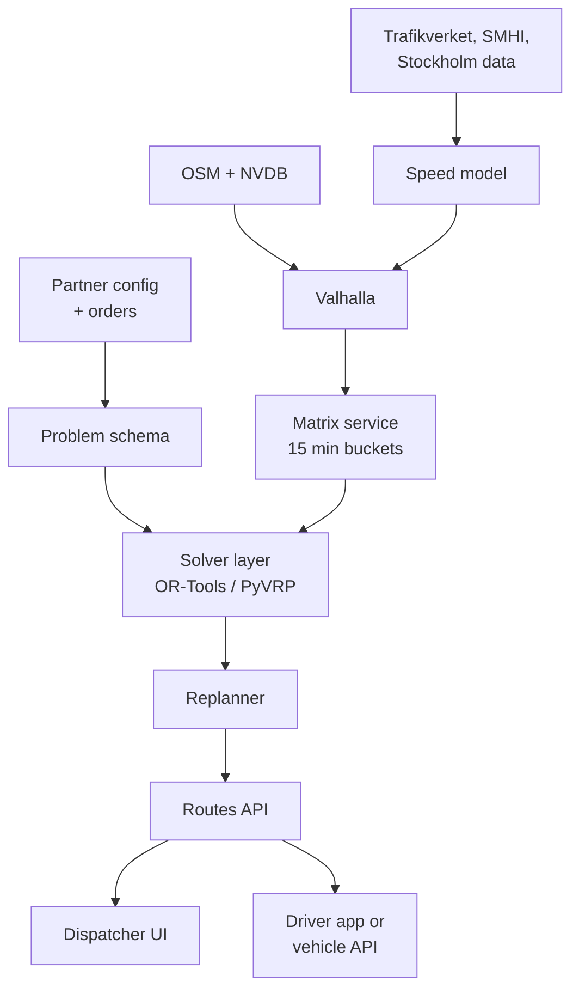

# Route Optimisation Engine: Idea & Research Directions

Hi everyone! This doc explains the idea behind our project and what I have found so far.

The idea is simple. A company tells our engine where it needs to go (the stops), which vehicles it has, what is a must, and what is most important. The engine then finds the best routes. It looks at traffic, road conditions and the size of each vehicle. We build one core engine and adjust it for each partner, because a parcel company and an e-scooter company like Voi need very different things.

Nothing here is final. I did some research to give us a starting point, but I want your ideas. If you think something is wrong, or you find a better way, please say it. That is the most useful thing you can do right now.

## The idea, and where I’d start

Below are my first guesses for the big questions. Use them as a starting point, not as answers.

| Open question | My starting guess | Why it’s worth testing |
|---|---|---|
| Road engine | [Valhalla](https://github.com/valhalla/valhalla) (MIT) | Truck height, weight, axle load and hazmat set per request; time dependent speeds; bike and scooter profiles |
| Solver | [OR-Tools](https://developers.google.com/optimization/routing) default, [PyVRP](https://pyvrp.org/) quality mode, [VROOM](https://github.com/VROOM-Project/vroom) baseline | OR-Tools covers the most constraints for free; PyVRP is 0.2 to 0.8% from best known solutions; VROOM runs in days |
| Priorities | Three level score: hard violations, then unserved priority, then weighted soft cost | Keeps “must” separate from “nice to have” so weights can’t break necessities |
| Traffic | Travel time matrices in 15 minute buckets; historical averages first, LightGBM second | No free street level probe data in Sweden, so start simple and log data from day one |
| Data | OSM + NVDB + Trafikverket API + Stockholm open data + SMHI | Free, mostly CC0, covers restrictions, incidents, road condition, weather |
| First vertical | Voi battery swap and rebalancing | Stockholm HQ, one of only two permitted operators since 1 July 2026, problem testable offline |
| December deliverable | Working engine, a Voi style demo on real Stockholm roads, a benchmark report | Pitch material for a pilot in Q1 2027 |

Things I don’t think we should do (but tell me if you disagree): build our own solver from zero, use neural network solvers, or build truck routing for Scania or Volvo, because they already build their own.

## What I want from you

Choose one track below. Read about its questions, try things out, and bring what you find to your 1:1 meeting with me in the week of 20 Oct. Ideas outside these tracks are welcome too.

| Track | Questions to dig into | Bring back |
|---|---|---|
| Algorithm | Is OR-Tools, PyVRP or something else the better core for our constraints? Would you model priorities differently from the three level score? Can traffic go inside the search, not just after it? Is there a hybrid or learned approach worth trying? | A small comparison on Solomon instances, or a counter proposal |
| Data | Where could we get street level speeds for Stockholm? How good are OSM and NVDB for truck restrictions? What does Trafikverket really cover? Which datasets did I miss? | A data map, ideally a first Valhalla or OSRM build on Sweden |
| Interface | How should a non expert set priorities and weights? What does a dispatcher need to see? How should drivers, or vehicles, receive routes? What do Routific or OptimoRoute get right and wrong? | Sketches or a clickable mock |
| Partners (anyone) | Which vertical has the clearest pain and data we could actually get? Is Voi right, or is there a better first partner? What would they measure us on? | A one pager on one vertical |

## The problem, formalised

A “necessity” is something the route must do (a hard rule). A “priority” is something we want, but can give up if needed (a soft rule). Here is one way to turn what a user says into rules for the solver:

| What the user says | Model term | How we encode it (OR-Tools) |
|---|---|---|
| “Must visit this stop” | Required stop | Left out of every disjunction ([docs](https://developers.google.com/optimization/routing/penalties)) |
| “This one is urgent” | Priority class | Drop penalty per class, spaced about 10x apart |
| “Deliver between 10 and 12” | Hard time window | `CumulVar(i).SetRange(a, b)` |
| “Ideally before 11” | Soft time window | `SetCumulVarSoftUpperBound`, coefficient scaled by class |
| “Truck is 4 m tall, 18 t” | Vehicle profile | Separate matrix per profile from Valhalla truck costing; forbidden roads cost infinity |
| “Only the van with a cooler” | Skills | `SetAllowedVehiclesForIndex` |
| “Swap any 5 of these 12 scooters” | Choose k of n | `AddDisjunction(idxs, penalty, max_cardinality=k)` |
| “Pick up here, drop there” | Pickup and delivery | `AddPickupAndDelivery` |
| “Fewer vans, shorter days, balanced routes” | Weighted objectives | Arc cost weights, span cost, fixed vehicle cost |

## The objective (The Math AI suggested)

\[
\min_x \bigl(H(x), P(x), S(x)\bigr)
\quad \text{in strict (lexicographic) order}
\]

\[
P(x)=\sum_{i\in U(x)} \pi_{c(i)}
\qquad
S(x)=\sum_k w_k \frac{f_k(x)}{s_k}
\]

- **H** counts hard violations. The engine only returns plans with \(H = 0\); otherwise it reports which constraint made the problem infeasible.
- **P** sums the penalty of every unserved stop \(U\), by class \(c\) (critical, high, normal, low). Classes are spaced about 10x so one high stop outweighs all normal ones.
- **S** is the soft cost: drive time, distance, class weighted lateness, overtime, vehicles used, route imbalance. Each term \(f\) is divided by a scale \(s\) taken from a reference solve, so weights mean the same thing across partners.

## Solvers: what’s out there

Starting guess: OR-Tools for constraint coverage, PyVRP for solution quality. Untested.

| Solver | Licence | Language | Strong at | Weak at |
|---|---|---|---|---|
| [OR-Tools 9.15](https://github.com/google/or-tools/releases) | Apache 2.0 | C++, Python | Widest constraint set; warm start and route locks for replanning | Quality drops above about 500 stops (14% gap at 1,000 stops after 1 min, [vendor benchmark](https://www.hexaly.com/benchmarks/hexaly-gurobi-or-tools-capacitated-vehicle-routing-problem-with-time-windows-cvrptw)) |
| [PyVRP 0.14](https://pyvrp.org/setup/benchmarks.html) | MIT | Python on C++ | 0.2 to 0.8% from best known; prizes, required stops, reloads, multi depot | No soft windows, no breaks, no time dependent travel |
| [VROOM 1.15](https://github.com/VROOM-Project/vroom/wiki/Benchmarks) | BSD 2 | C++, JSON API | 100 stops in about 0.4 s; priority 0 to 100; skills; shipments | No soft windows, no time dependence, fixed cost model |
| [Timefold 2.5](https://timefold.ai/pricing) | Apache 2.0 core, paid tiers | Java | Any constraint in code, native score levels, live changes | Key scaling features are Enterprise only; Python binding archived |
| [jsprit 2.0](https://github.com/graphhopper/jsprit) | Apache 2.0 | Java | Time dependent travel | Small community |
| LKH-3, Hexaly, Gurobi, Nextmv | Academic only or commercial | Various | Strong quality | Licences block partner use |
| Neural solvers (POMO, RouteFinder) | Mostly MIT | PyTorch | Research | Gap jumps from 3.7% to 34% when capacity shifts ([paper](https://arxiv.org/html/2505.24627v1)); not production ready |

## Road network, vehicle size and traffic

Starting guess: Valhalla, for per request truck dimensions and time dependent speeds. OSRM if it’s too slow; benchmark both.

| Engine | Licence | Vehicle size | Time dependent | Self hosted matrix |
|---|---|---|---|---|
| [Valhalla 3.9](https://valhalla.github.io/valhalla/api/route/api-reference/) | MIT | Per request: height, width, length, weight, axle load, axle count, hazmat; bicycle, scooter, pedestrian | Yes: weekly profiles in 5 min buckets plus live traffic file | Yes, slower (2017 test: 1,000x1,000 in about 111 s; reworked since, must re-measure) |
| [OSRM 26.9](https://github.com/Project-OSRM/osrm-backend) | BSD 2 | Baked in at build time, one dataset per vehicle class, no hazmat | No; swap speeds by re-running customise | Yes, fastest (10k x 10k about 8 s reported) |
| [GraphHopper 11](https://github.com/graphhopper/graphhopper) | Apache 2.0 | Per request custom models, truck and cargo bike files | No traffic in open source | No, commercial only |
| [OpenRouteService 9.10](https://github.com/GIScience/openrouteservice) | GPL 3 | `driving-hgv` profile | No | Yes, slow for HGV |

## Data sources

Most of the data we need is free. The missing piece is traffic speed on small city streets in Stockholm.

| Source | What it gives us | Access | Use |
|---|---|---|---|
| [Trafikverket Open API](https://www.trafikverket.se/e-tjanster/trafikverkets-oppna-api-for-trafikinformation/) | Situation (roadworks, accidents), TrafficFlow, TravelTimeRoute, RoadCondition, weather stations, ferries | Free key, CC0, no hard quota | Live layer, speed history |
| [NVDB in the Open API](https://bransch.trafikverket.se/tjanster/data-kartor-och-geodatatjanster/nyheter-om-trafikverkets-data/2025/nvdb-vagdata-tillgangliga-i-trafikverkets-datautbytesportal-for-anvandning-i-oppet-api/) and [Lastkajen](https://www.trafikverket.se/e-tjanster/lastkajen--sveriges-vag--och-jarnvagsdata/) | Bearing class (BK1 64 t to BK4 74 t), height limits, weight, width and length limits, banned turns, speed limits, environmental zones | Free, CC0, GeoPackage | Truck restrictions, better than OSM tags |
| [Stockholm open street data](https://openstreetgs.stockholm.se/home/Data) | Loading zones, truck parking, height limits, street works, e-scooter parking, traffic counts | Free key; moving to OGC API Features in 2026 | Last 50 m rules |
| [Stockholm parking rules API](https://openstreetgs.stockholm.se/home/Parking) | Truck parking, street cleaning bans | Free key | Stop feasibility |
| [SMHI forecasts](https://opendata.smhi.se/apidocs/metfcst/index.html) | SNOW1gv1 weather forecast (the old pmp3g API shut 31 Mar 2026) | No key | Winter speed factors |
| [Trafiklab KoDa](https://www.trafiklab.se/api/our-apis/koda/) | Historical SL bus positions since Dec 2020 | Free key | Congestion proxy on city streets |
| [TomTom free tier](https://docs.tomtom.com/pricing) | Traffic flow tiles, routing with traffic | Free up to monthly limits | Ground truth spot checks |
| OSM Sweden | Base road graph | ODbL | Graph, joined with NVDB |

## Benchmarks and test data

| Dataset | What it tests | Licence |
|---|---|---|
| [Solomon](https://www.sintef.no/projectweb/top/vrptw/solomon-benchmark/) and [Gehring & Homberger](https://www.sintef.no/projectweb/top/vrptw/homberger-benchmark/) | Time windows, 25 to 1,000 stops, best known solutions | Free |
| [CVRPLIB X and XL](https://galgos.inf.puc-rio.br/cvrplib/index.php/en/instances) | Capacity, 100 to 10,000 stops | Free |
| [Li & Lim](https://www.sintef.no/projectweb/top/pdptw/li-lim-benchmark/) | Pickup and delivery | Free |
| [Amazon Last Mile 2021](https://registry.opendata.aws/amazon-last-mile-challenges/) | 9,184 real routes with real travel times | CC BY-NC, research only |
| [LaDe](https://huggingface.co/datasets/Cainiao-AI/LaDe) | 10.7M real deliveries with GPS | Apache 2.0 |
| [SUMO](https://eclipse.dev/sumo/) | Simulates Stockholm traffic from OSM to test plans under congestion | EPL 2.0 |

## A possible architecture

This is only a sketch. The main idea: every part uses one shared format to describe the problem. That way the same result can go to a driver’s phone app or straight to a self driving vehicle.

## Rough shape to December

This is a rough plan, not a promise. The first three weeks are for exploring. We decide the later steps together, based on what you find.

| Phase | Dates | Focus | Outcome |
|---|---|---|---|
| 0 · Explore and propose | 28 Sep to 18 Oct (3 wks) | Each track researches its questions, tries a tool or two, and brings ideas | Proposals at the kickoff; we agree the approach together in the 1:1s |
| 1 · First working engine | 19 Oct to 8 Nov (3 wks) | Whatever stack we agreed, end to end on Stockholm roads | A real Stockholm instance solved with priorities and drawn on a map |
| 2 · Traffic and replanning | 9 Nov to 29 Nov (3 wks) | Time of day travel times, replanning when things change | Evidence that traffic awareness actually improves plans |
| 3 · Demo and interface | 30 Nov to 20 Dec (3 wks) | A partner style scenario, dispatcher UI, benchmark report | A demo and report we can take to a partner |
| Next · Pilot | Jan to Mar 2027 | Real partner data | Partner signs off on a shadow run |

## Partners and market

Many companies already sell general route planning, so I think we should start with one type of business first. “Priority” means very different things in each one:

| Vertical | Priority in practice | Fit for us now |
|---|---|---|
| Micromobility (Voi) | Rides lost if a scooter stays flat, weighted by predicted demand per zone and hour; cost of breaking parking rules | Best |
| Parcel (PostNord, DHL) | SLA tier, time window, cost of a failed first attempt | Saturated and cheap |
| Food (Wolt, Foodora) | Freshness, batching, one courier at a time dispatch | Core to their business, real time |
| Heavy trucks (Scania, Volvo) | Bearing class, height, EU driving time rules (9 h a day, 45 min break after 4.5 h) | They build in house |
| Home care | Carer continuity, skills, care decision windows | Health data under GDPR, Caire already there |

## Open questions

- Vertical first, or stay general longer?
- First partner: Voi, or something with easier data?
- Where do we get street level speeds?
- Server: the MLOps project’s box or our own?
- What did this doc miss?

## Sources

### Solvers

- [OR-Tools releases](https://github.com/google/or-tools/releases), [penalties and dropping visits](https://developers.google.com/optimization/routing/penalties), [time windows](https://developers.google.com/optimization/routing/vrptw)
- [PyVRP benchmarks](https://pyvrp.org/setup/benchmarks.html), [PyVRP paper](https://arxiv.org/abs/2403.13795)
- [VROOM benchmarks](https://github.com/VROOM-Project/vroom/wiki/Benchmarks), [VROOM API](https://github.com/VROOM-Project/vroom/blob/master/docs/API.md)
- [Timefold pricing](https://timefold.ai/pricing), [Timefold score levels](https://docs.timefold.ai/timefold-solver/latest/constraints-and-score/overview)
- [Hexaly CVRPTW benchmark (vendor)](https://www.hexaly.com/benchmarks/hexaly-gurobi-or-tools-capacitated-vehicle-routing-problem-with-time-windows-cvrptw)
- [Neural solver generalisation study](https://arxiv.org/html/2505.24627v1)

### Routing engines

- [Valhalla API reference](https://valhalla.github.io/valhalla/api/route/api-reference/), [Valhalla speeds](https://valhalla.github.io/valhalla/concepts/speeds/), [Valhalla matrix](https://valhalla.github.io/valhalla/api/matrix/)
- [OSRM](https://github.com/Project-OSRM/osrm-backend), [OSRM traffic](https://github.com/Project-OSRM/osrm-backend/wiki/Traffic)
- [GraphHopper custom models](https://github.com/graphhopper/graphhopper/blob/master/docs/core/custom-models.md), [OpenRouteService](https://github.com/GIScience/openrouteservice)
- [Geofabrik Sweden](https://download.geofabrik.de/europe/sweden.html), [TomTom pricing](https://docs.tomtom.com/pricing), [Google Routes billing](https://developers.google.com/maps/documentation/routes/usage-and-billing)

### Swedish data

- [Trafikverket Open API](https://www.trafikverket.se/e-tjanster/trafikverkets-oppna-api-for-trafikinformation/), [NVDB in the Open API](https://bransch.trafikverket.se/tjanster/data-kartor-och-geodatatjanster/nyheter-om-trafikverkets-data/2025/nvdb-vagdata-tillgangliga-i-trafikverkets-datautbytesportal-for-anvandning-i-oppet-api/), [Lastkajen](https://www.trafikverket.se/e-tjanster/lastkajen--sveriges-vag--och-jarnvagsdata/), [bearing classes](https://bransch.trafikverket.se/for-dig-i-branschen/vag/bk--barighetsklasser-pa-vagar-och-broar)
- [Stockholm open street data](https://openstreetgs.stockholm.se/home/Data), [Miljözon class 3](https://trafik.stockholm/trafikregler/miljozoner/miljozon-klass-3/), [e-scooter rules](https://trafik.stockholm/trafikregler/elsparkcyklar/)
- [SMHI forecast API](https://opendata.smhi.se/apidocs/metfcst/index.html), [Trafiklab KoDa](https://www.trafiklab.se/api/our-apis/koda/)

### Benchmarks and simulation

- [Solomon](https://www.sintef.no/projectweb/top/vrptw/solomon-benchmark/), [Gehring & Homberger](https://www.sintef.no/projectweb/top/vrptw/homberger-benchmark/), [CVRPLIB](https://galgos.inf.puc-rio.br/cvrplib/index.php/en/instances), [Li & Lim](https://www.sintef.no/projectweb/top/pdptw/li-lim-benchmark/)
- [Amazon Last Mile](https://registry.opendata.aws/amazon-last-mile-challenges/), [LaDe](https://huggingface.co/datasets/Cainiao-AI/LaDe), [SUMO](https://eclipse.dev/sumo/)

### Modelling research

- [Ichoua et al., time dependent VRP](https://www.sciencedirect.com/science/article/abs/pii/S0377221702001479), [Marler & Arora, weighted sums](https://link.springer.com/article/10.1007/s00158-009-0460-7)
- [Google Maps ETA with graph nets](https://arxiv.org/abs/2108.11482), [STID](https://arxiv.org/abs/2208.05233)
- [ReEvo](https://arxiv.org/abs/2402.01145), [ARS natural language to VRP](https://arxiv.org/html/2508.03406v1)

### Market

- [Routific](https://www.routific.com/pricing), [OptimoRoute](https://optimoroute.com/pricing/), [Nextmv](https://www.nextmv.io/pricing), [Google Route Optimization](https://developers.google.com/maps/documentation/route-optimization/overview), [HERE Tour Planning](https://www.here.com/platform/tour-planning)
- [Caire](https://www.caire.se/produkt/funktioner/ruttoptimering-hemtjanst), [Einride Saga](https://www.einride.tech/saga-ai)
- [SVT on Stockholm scooter permits](https://www.svt.se/nyheter/lokalt/stockholm/farre-elsparkcykelbolag-tillats-i-stockholm-parkeringsvakten-kaos), [Voi Q2 2025](https://micromobility.substack.com/p/profitable-at-scale-vois-q2-2025)
- [Lee, Lee & Park 2024, swap and rebalance](https://www.sciencedirect.com/science/article/abs/pii/S1366554524001315), [Koca & Sharafi 2026](https://www.sciencedirect.com/science/article/abs/pii/S0305054825003776)
